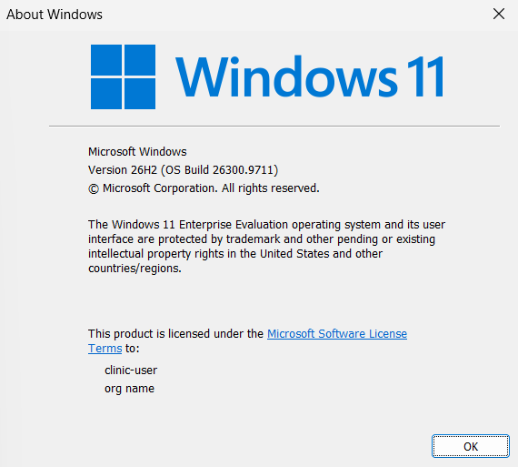
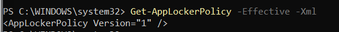
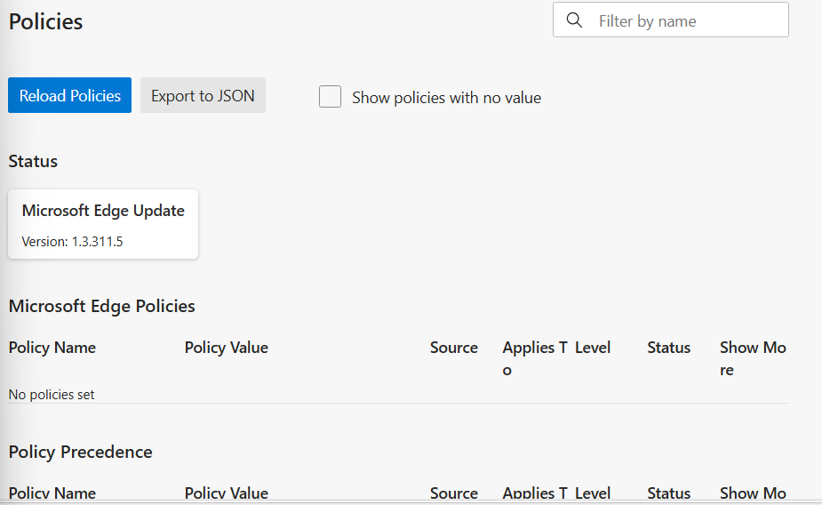
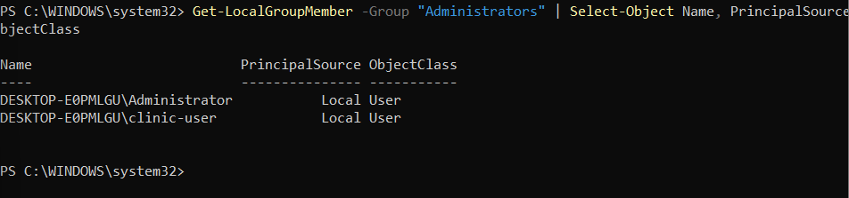
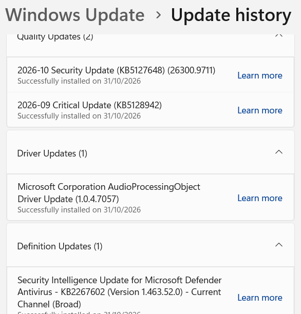
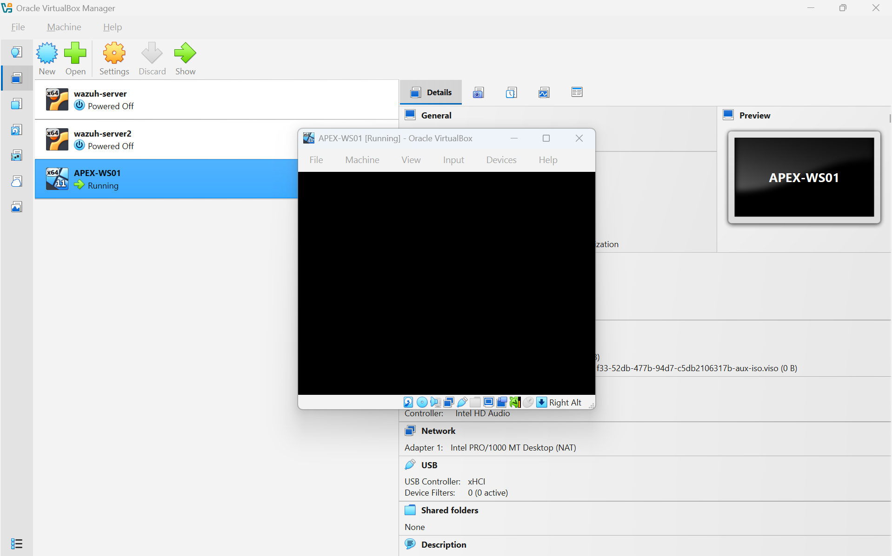

# ACSC Essential Eight Review: Apex Allied Health

**Project by:** Ryan Barby

**Scenario:** Fictional Australian allied health clinic
**Framework Reference:** ACSC Essential Eight (targeting Maturity Level 1 requirements)
**Endpoint Tested:** `APEX-WS01` (Windows 11 Enterprise Evaluation virtual machine in VirtualBox)
**Scope Note:** This was a hands-on learning lab using a single test computer. It was not an audit of a live business or its cloud accounts.

---

## 1. Background and Goal

After completing my CompTIA A+, Network+, Security+, and CySA+ certifications, I wanted to move past multiple-choice exam questions and practise applying cybersecurity frameworks to a realistic Australian business scenario.

I created **Apex Allied Health** as a fictional five-person private clinic in regional NSW (consisting of a clinic director, two clinicians, a practice manager, and a receptionist). To keep things realistic, I based their operations around software tools commonly used by Australian allied health practices:

* **Cliniko:** Electronic health records, patient medical notes, and appointment scheduling.
* **Tyro Health & Stripe:** Processing Medicare claims, private health fund rebates, and credit cards.
* **Microsoft 365:** Staff email, patient referral letters, and general documents.
* **Xero:** Financial records, payroll, and business tax data.
* **Staff Laptops (`APEX-WS01`):** Daily work machines used to log into these web tools.
* **Clinic Domain & Email:** `apexalliedhealth.com.au` for business identity and patient contact.
* **ActiveCampaign:** Email newsletters and general patient inquiries (kept separate from medical records).

Because the fictional clinic handles sensitive medical notes, treatment histories, and billing data, protecting access to that information is an important real-world security concern under Australian privacy expectations. However, this lab focused strictly on technical endpoint security checks and did not evaluate legal or regulatory compliance.

My goal for this project was to:

1. Use the **ACSC Essential Eight (Maturity Level 1)** as a baseline to see what basic security controls look like on a Windows endpoint.
2. Practise running read-only PowerShell commands to inspect real system settings.
3. Learn how to connect technical findings to practical business risks, while being honest about what a single lab virtual machine can and cannot prove.

---

## 2. Essential Eight Audit Evidence

To test this safely, I set up a dedicated Windows 11 Enterprise virtual machine named `APEX-WS01` in VirtualBox. I created an everyday local account named `clinic-user` to mimic a staff member's laptop.

### Lab operating system

*The Windows version dialog shows Windows 11 Enterprise Evaluation, version 26H2, OS build 26300.9711.*

Here is what I found when running checks on that test machine:

| Essential Eight Strategy | What I Checked | What I Found & What It Means |
|---|---|---|
| **1. Application Control** | Checked whether AppLocker or code integrity rules restricted unapproved software from running. | AppLocker had no active rules configured, and user-mode code integrity was only set to Audit mode. This means any executable could run on this machine without being blocked. |
| **2. Microsoft Office Macros** | Looked for installed desktop versions of Word, Excel, or Microsoft 365. | Desktop Office apps were not installed on this VM (mimicking a web-only usage model). I recorded this as **Not Deployed on this endpoint**. This check cannot confirm how Office macros are handled on other clinic computers. |
| **3. Patch Applications** | Queried the registry for installed software and checked the update status of Microsoft Edge. | Edge, Edge WebView2 Runtime, VirtualBox Guest Additions, and OneDrive were installed. Edge reported it was up to date. However, this single check did not show how often third-party apps are patched or whether a central patch tool is used. |
| **4. User Application Hardening** | Checked if outdated PowerShell 2.0 was installed and looked for browser policy restrictions. | PowerShell 2.0 was absent (compliant with downgrade mitigation). However, Edge reported "No policies set", and the Chrome policy registry key was empty, meaning there were no restrictions on browser extensions or plugins. |
| **5. Restrict Administrative Privileges** | Checked which accounts belonged to the local Administrators group. | The everyday `clinic-user` account was an administrator on the machine. This gives daily staff accounts full control to install software or change system settings. |
| **6. Patch Operating Systems** | Checked the Windows build number and installed update history. | Windows Update History showed a cumulative security update successfully installed on 31 October 2026. This proved the VM was updated recently, but it did not assess whether the clinic has an ongoing patching schedule. |
| **7. Multi-Factor Authentication (MFA)** | Attempted to verify MFA settings from the local machine. | **Not assessed from this machine.** A standalone local VM cannot see whether MFA is turned on for cloud accounts like Cliniko, Xero, or Microsoft 365. That requires checking the admin portals of those services. |
| **8. Regular Backups** | Checked if Windows Volume Shadow Copy (VSS) was running and if shadow copies existed. | The VSS service was stopped and set to Manual, and no local shadow copies were found. This shows local shadow copies were off, but it does not prove whether cloud or business backups exist elsewhere. |

### Selected evidence screenshots

#### Application control — AppLocker policy

*The effective AppLocker policy returned no rule collections. This screenshot shows the AppLocker result only; it does not prove that every application can run.*

#### Browser hardening — Edge policies

*Edge reported “No policies set” when I checked its policy page.*

#### Administrative privileges — local group membership

*The local Administrators group included `clinic-user`. `APEX-WS01` is the VirtualBox VM name; the Windows-generated computer name is visible in this output.*

#### Operating system patching — update history

*Windows Update History shows the October 2026 Security Update installed on 31 October 2026. This records an installed update, not a full patch-compliance assessment.*

---

## 3. Initial Maturity Summary

Using the ACSC Essential Eight Maturity Level 1 (ML1) requirements as a guide, here is how the test machine stacks up:

| Strategy | Initial Lab Finding | What Supports This |
|---|---|---|
| **1. Application Control** | **Gap Identified** | No active AppLocker rules; any program can run. |
| **2. Microsoft Office Macros** | **Not Deployed** | Desktop Office not installed on this VM; attack surface absent locally. |
| **3. Patch Applications** | **Partially Verified** | Edge was current, but no central third-party patch tool was identified. |
| **4. User Application Hardening** | **Gap Identified** | PowerShell 2.0 was removed, but browser extension policies were unmanaged. |
| **5. Restrict Administrative Privileges** | **Gap Identified** | Everyday user account has local administrator access. |
| **6. Patch Operating Systems** | **Partially Verified** | Recent security updates were applied, but full business update cadence is unverified. |
| **7. Multi-Factor Authentication** | **Not Assessed** | Cloud tenant settings cannot be verified from a local VM. |
| **8. Regular Backups** | **Not Assessed** | No local shadow copies found; clinic cloud backup coverage requires separate review. |

---

## 4. Initial Risk Register

To connect these technical findings to the business, I mapped out an initial risk register.

I used a standard **5x5 rating scale** (Likelihood 1–5 × Impact 1–5):

* **Score 1–8:** Low Risk
* **Score 9–11:** Medium Risk
* **Score 12–25:** High / Critical Risk

| Risk ID | Observed Issue / Gap | Possible Business Impact | Likelihood (1–5) | Impact (1–5) | Score | Priority Level |
|---|---|---|:---:|:---:|:---:|:---:|
| **RSK-01** | Staff user account has local admin rights (`clinic-user` in Administrators group). | If staff click a malicious attachment or link, malware gets full administrative access to install tools, tamper with files, or disable security software. | 3 | 4 | **12** | **High** |
| **RSK-02** | MFA settings for cloud portals (Cliniko, M365) could not be verified from the VM. | Because health notes and billing live in the cloud, a stolen staff password without an MFA prompt gives an attacker direct access to confidential patient files. | 3 | 5 | **15** | **High** |
| **RSK-03** | Browser policies are completely unmanaged (no extension restrictions in Edge). | Clinicians work through web browsers all day. An unvetted or malicious browser extension could read web pages, capture passwords, or steal patient notes. | 3 | 3 | **9** | **Medium** |
| **RSK-04** | Backup and restore processes were not verified (no local shadow copies found). | If a ransomware attack or accidental deletion occurs, the clinic cannot operate or treat patients without reliable, tested backups. *(Rated High priority due to maximum business impact).* | 2 | 5 | **10** | **High** |
| **RSK-05** | Application control is not active (AppLocker rules were empty). | Staff could download and run unapproved software or unauthorized third-party utilities without IT oversight. | 3 | 3 | **9** | **Medium** |
| **RSK-06** | No central system to monitor and update third-party software. | If third-party tools (like PDF readers or runtimes) fall behind on security updates, they leave known software flaws open to opportunistic exploit scripts. | 3 | 4 | **12** | **High** |

---

## 5. Suggested Remediation Steps

For a small clinic without dedicated in-house IT, fixes should focus on high-impact, low-cost steps first before rolling out complex controls:

| Priority | Recommended Action | Why This Matters |
|---|---|---|
| **1. Enforce Cloud MFA** | Check Microsoft 365, Cliniko, and Xero portals and turn on mandatory Multi-Factor Authentication (MFA) for every staff account. | Stops credential theft and password phishing from leading straight to a clinical data breach. |
| **2. Remove Local Admin Rights** | Make daily staff logins standard user accounts. Create a separate, password-protected local admin account strictly for setup tasks. | Prevents accidental malware execution or rogue software from getting full control over staff laptops. |
| **3. Manage Browser Extensions** | Use a basic Intune or local Group Policy setting in Microsoft Edge to block unapproved browser extensions. | Protects browser sessions where clinical and billing notes are handled daily. |
| **4. Automate Software Updates** | Turn on automatic background updates for Windows and all installed browsers and PDF readers. | Keeps software up to date against known flaws without requiring manual checks. |
| **5. Verify Backups & Test a Restore** | Check data retention settings inside Cliniko and Xero, export periodic offline data snapshots, and run a test restore of critical files. | Proves the clinic can recover patient records if data is deleted, corrupted, or locked. |
| **6. Pilot Application Control** | Test basic AppLocker or Windows Defender Application Control (WDAC) rules in Audit mode first before enforcing blocks. | Prevents unapproved executables from running while ensuring legitimate clinical tools are not accidentally blocked. |

---

## What I Learned & Reflections

Coming into this project with my CompTIA certifications, my goal was to bridge the gap between exam theory and practical IT security work. Several key lessons stood out:

* **Using AI as a Technical Tutor:** Because I am at an entry-level stage in my cybersecurity career, I don't have years of enterprise experience or every PowerShell syntax memorized. I used AI as an interactive research assistant and tutor throughout this lab. It helped me break down ACSC documentation, suggested read-only PowerShell commands to query Windows settings, and helped me interpret terminal outputs. This taught me how to ask targeted technical questions, verify command safety before executing anything, and use modern tools to speed up my learning.
* **Hands-on Windows & PowerShell Practice:** Running these checks gave me practical experience using the command line to inspect system configurations—querying WMI/CIM objects, searching registry hives (`HKLM` and `HKCU`), checking local groups, and reviewing AppLocker rules and patch histories. Seeing where security settings actually live in Windows was a big step forward.
* **Virtual Machine Setup & Troubleshooting:** Building `APEX-WS01` in VirtualBox gave me hands-on hypervisor experience. Configuring Windows 11 Enterprise meant working with EFI, Secure Boot, and virtual TPM 2.0 settings. I also ran into a real roadblock during setup: a VirtualBox bug where assigning 2 vCPUs caused a black-screen UEFI hang during boot. I diagnosed and resolved this by reconfiguring the VM to 3 vCPUs and 6 GB of RAM. Troubleshooting that issue myself made the lab feel very realistic.
* **The Essential Eight in Practice:** Learning about frameworks in study guides is very different from testing them. I learned that controls like Application Control aren't just simple toggle switches—they involve background services, policy engines, and specific event logs that need monitoring.
* **Understanding Lab Limitations:** One of my biggest takeaways was recognizing what a single virtual machine cannot prove. An isolated test laptop cannot tell you if a clinic has cloud MFA configured, nor does the absence of local shadow copies prove a business has no backups. Acknowledging those boundaries kept my review honest rather than making claims the lab couldn't support.

### Lab setup — black-screen troubleshooting

*The VM displayed a black screen during setup. This screenshot records the symptom; it does not establish the cause or prove a specific VirtualBox bug.*

---

## Appendix: Selected PowerShell Checks

Below are the read-only PowerShell commands executed during the audit on `APEX-WS01`:

* **Application Control Policy:**
  `Get-AppLockerPolicy -Effective -Xml`
* **Device Guard / Code Integrity Status:**
  `Get-CimInstance -Namespace root\Microsoft\Windows\DeviceGuard -ClassName Win32_DeviceGuard`
* **PowerShell 2.0 Optional Feature:**
  `Get-WindowsOptionalFeature -Online | Where-Object { $_.FeatureName -like "*PowerShellV2*" }`
* **Local Administrators Group Members:**
  `Get-LocalGroupMember -Group "Administrators"`
* **Installed Applications (Machine-Wide & Current User):**
  `Get-ItemProperty HKLM:\Software\Microsoft\Windows\CurrentVersion\Uninstall\*, HKLM:\Software\Wow6432Node\Microsoft\Windows\CurrentVersion\Uninstall\* | Select-Object DisplayName, DisplayVersion`
  `Get-ItemProperty HKCU:\Software\Microsoft\Windows\CurrentVersion\Uninstall\* | Select-Object DisplayName, DisplayVersion`
* **Windows Update History:**
  `Get-HotFix | Sort-Object InstalledOn -Descending | Select-Object -First 5 HotFixID, Description, InstalledOn`
* **Windows Build & Revision Details:**
  `Get-ItemProperty 'HKLM:\SOFTWARE\Microsoft\Windows NT\CurrentVersion' | Select-Object DisplayVersion, CurrentBuild, UBR`
* **Volume Shadow Copy Service Status:**
  `Get-Service -Name VSS`
* **Shadow Copy Instances:**
  `Get-CimInstance -ClassName Win32_ShadowCopy`
